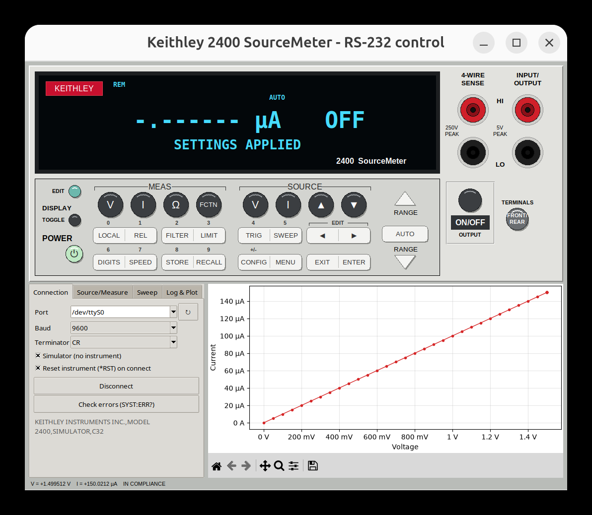

# Keithley 2400 SourceMeter GUI

A desktop app for controlling a **Keithley 2400 SourceMeter** over **RS-232**.
The window looks and works like the instrument's own front panel, and it adds a live plot,
CSV logging and I-V sweeps.



*No instrument at hand?* Start it with `--sim` and try everything with the built-in
simulator (a 10 kΩ resistor).

---

## Features

- **Front-panel look and feel**: the display and keys behave like the real 2400 (see the [key map](#front-panel-keys)).
- **Source voltage or current**, with level, compliance, output on/off, front/rear terminals and 2- or 4-wire sensing.
- **Live readings** of V, I and R = V/I, with range, filter, REL (zero), digits and speed (NPLC).
- **Safe ramping**: the source ramps up and down at a set rate when the output is switched or the level changes (optional).
- **Live plot** of "V & I vs time" or "I vs V", with zoom/pan, export to PNG, and export of the plotted data to CSV.
- **CSV logging** of every reading, with timestamps.
- **Linear I-V sweep**, with the result plotted as I vs V.
- **Built-in simulator** for trying the app without hardware.
- **Scales to your screen**: the window sizes itself from the screen resolution, and it works on HiDPI screens too.

## Requirements

- Python 3.8 or newer, with Tkinter
- [`pyserial`](https://pypi.org/project/pyserial/) and [`matplotlib`](https://pypi.org/project/matplotlib/)
- An RS-232 port or a USB-to-RS-232 adapter, plus a cable to the 2400's RS-232 connector

## Installation

```bash
git clone https://github.com/mohaas33/k2400.git
cd k2400
python3 -m venv .venv
source .venv/bin/activate            # Windows: .venv\Scripts\activate
pip install -r requirements.txt
```

<details>
<summary><b>Linux notes</b></summary>

- Tkinter is a separate package on many distributions:
  `sudo apt install python3-tk` (Debian/Ubuntu) or `sudo dnf install python3-tkinter` (Fedora).
- To use serial ports without `sudo`, add yourself to the `dialout` group, then log out and back in:
  `sudo usermod -aG dialout $USER`
- USB adapters usually appear as `/dev/ttyUSB0`. Built-in ports are `/dev/ttyS0` and similar.
</details>

<details>
<summary><b>Windows / macOS notes</b></summary>

- The python.org installers include Tkinter.
- Ports are called `COM3` etc. on Windows and `/dev/tty.usbserial-…` on macOS.
  Install the driver for your USB adapter if the port doesn't show up.
</details>

## Quick start

```bash
python k2400_gui.py --sim     # try it with the simulator
python k2400_gui.py           # real instrument
```

1. **Set up the instrument for RS-232** (once, on the 2400 front panel):
   `MENU → COMMUNICATION → RS-232`. Then set the baud rate (e.g. **9600**), **8** data bits,
   parity **NONE**, terminator **<CR>**, flow control **NONE**.
   *Selecting RS-232 turns GPIB off.*
2. In the **Connection** tab, pick the **Port**, and set the same **Baud** and **Terminator** as on the instrument.
3. Press **POWER** (or **Connect**). The status bar shows the instrument's `*IDN?` reply.
4. Choose **SOURCE V** or **I**. Set the level and compliance with the **▲ / ▼** and **◀ / ▶** keys,
   or type them in the **Source/Measure** tab and press **Apply (ENTER)**.
   Values like `1.5`, `100m`, `105u` and `2e-3` all work.
5. Press **ON/OFF OUTPUT**.

> **Tip:** if `*IDN?` times out and the settings match, try a **null-modem** cable instead of a straight DB-9 cable.

## Command-line options

| Option | Description |
|---|---|
| `--sim` | Start connected to the built-in simulator |
| `--scale N` | Fixed UI scale, e.g. `0.8`, `1`, `1.5`, `2` |
| `--geometry WxH` | Window size in pixels, e.g. `1600x1000`. The UI is scaled to fit it |

By default the window fills about 85 % of the screen. Use `--scale` or `--geometry` if you prefer another size.

## Front-panel keys

| Key | Action |
|---|---|
| **POWER** | Connect / disconnect |
| **MEAS V / I / Ω** | Choose what the large reading shows. **FCTN** cycles through them |
| **SOURCE V / I** | Source function (turns the output off first) |
| **SOURCE ▲ / ▼** | Change the digit under the blinking cursor (applied immediately) |
| **EDIT ◀ / ▶** | Move the cursor |
| **EDIT** (teal key) | Switch editing between source level and compliance |
| **DISPLAY TOGGLE** | Bottom line: source/compliance ↔ the other readings |
| **RANGE ▲ / AUTO / ▼** | Measurement range |
| **ON/OFF OUTPUT** | Output on/off |
| **FRONT/REAR** | Select terminals (turns the output off first) |
| **LOCAL** | Return the instrument to front-panel control |
| **REL** | Zero the present reading (toggle) |
| **FILTER** | 10-reading repeating average on/off |
| **DIGITS / SPEED** | Display resolution / integration time (NPLC) |
| **STORE / RECALL** | Start or stop CSV logging / show how many readings were logged |
| **TRIG** | Take one reading |
| **SWEEP** / **EXIT** | Run the I-V sweep / abort it |
| **CONFIG / MENU** | Open the settings tabs |
| **ENTER** | Apply the level/compliance typed in the side panel |

## Settings tabs

- **Connection**: port, baud rate, terminator, simulator, `*RST` on connect, read the error queue.
- **Source/Measure**: source function, level, compliance, 4-wire, speed, poll interval, ramp on/off and ramp rate.
- **Sweep**: start, stop, number of points and delay. The output must be **OFF** to start a sweep, and it turns off again at the end.
- **Log & Plot**: CSV log file, plot mode, clear the plot, save the plot as PNG, save the plotted data as CSV.

### CSV format

Each logged reading is one row:

```
timestamp,elapsed_s,voltage_V,current_A,resistance_ohm,source_func,source_level,compliance,in_compliance,mode
2026-11-24T09:53:49.822,0.491,1.000017E+00,1.000249E-04,9.997681E+03,VOLT,1.000000E+00,1.050000E-04,0,monitor
```

## Troubleshooting

| Problem | What to check |
|---|---|
| `*IDN?` timeout | Baud rate and terminator must match the instrument. Check the cable (null-modem?) and that the interface is RS-232, not GPIB |
| `Permission denied: /dev/ttyUSB0` | Join the `dialout` group (see Linux notes) |
| Port missing from the list | Plug in the adapter, then press **↻** next to the port list |
| **CMPL** blinks on the display | The output has hit the compliance limit. Raise the compliance or lower the level |
| Window too big or too small | Start with `--scale 0.8` or `--geometry 1400x900` |
| `No module named tkinter` | Install the Tkinter package (see Linux notes) |

## License

[MIT](LICENSE)
